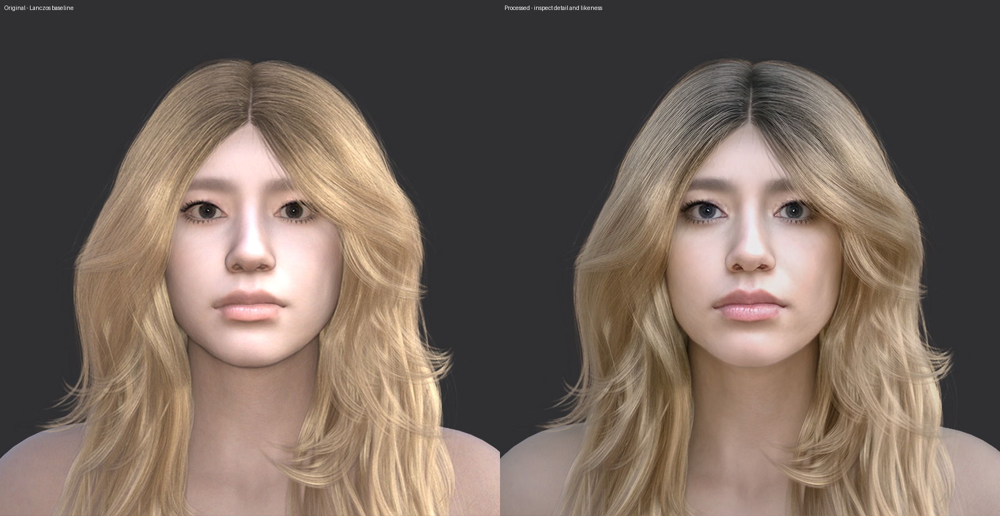

# Puente Iray Preview

**Explore neural previews and process Iray renders directly in Daz Studio.**
Puente Iray Preview is a free experimental plugin from Puente Labs for
**Daz Studio 6 on Windows x64**, with optional **Real-ESRGAN 2x/4x upscaling**.

The Full beta package bundles the processing worker, Python, and its dependencies.
You do not need to select a Python environment or use ComfyUI.

## Current release status

**Preparing beta `0.3.0-beta.1`: source code is public; the packaged beta is not
yet generally available.** The new plugin DLL has passed tests inside Daz Studio.
Distribution binaries remain in draft while the permissions and dependency
reviews described below are completed. See the [draft release notes](RELEASE_NOTES.md).

## Visual comparison

**Left:** reference enlarged with Lanczos. **Right:** neural enhancement plus
Real-ESRGAN 4x upscaling. Both paths start from the same 720 x 720 Iray render
and are compared at a matching output resolution. This is one scene and one
configuration; it illustrates changes in the visual finish, not a general
performance or compatibility benchmark.

[Explore the interactive comparison and processing details](https://puentelabs.org/research/dlss-for-daz/).

## What it does

- Neural Iray preview inside Daz Studio.
- Render processing, including automatic Direct-to-File processing and processing
  of existing images.
- Optional Real-ESRGAN upscaling at 2x or 4x.

This is an experimental workflow, not a claim of general compatibility, faster
rendering at equivalent quality, or equivalence to DLSS in games.

## Bring your own NVIDIA NR runtime

The NVIDIA NR runtime is **not included**. The **Importar DLL NR...**
(Import NR DLL) button accepts a compatible `nvngx_dlssnr.dll` that you have the
right to use, verifies the copied file, and prepares a local folder alongside
the open-source helper. It does not download or patch the DLL. The NVIDIA driver
is a system requirement.

Bring-your-own setup avoids redistribution of that runtime; it does not establish
all rights of use. Authorization for the initialization contract/IDs and helper,
the agreement applicable to the exact runtime, and the final review of Full-worker
dependencies remain pending. See the
[backend permissions review](docs/backend-permissions-review-2026-10-19.md).

## What has been tested

Tested with **Daz Studio 6.25.2026.14722**, an **RTX 4090**, NVIDIA driver
**617.42**, and **Windows x64**. The following passed:

- Repeated bring-your-own runtime imports.
- Render processing with NR/2x, automatic Direct-to-File processing, and processing
  of existing images.
- Preview, cancellation, and recovery.
- NR and Real-ESRGAN 2x/4x in the Full worker without an external Python on `PATH`.

Only this configuration is verified. Compatibility with other GPUs or Daz versions
has not been established. See the [testing record](docs/TESTING.md).

## Installation and building

The package keeps `plugins/dsp_PuenteIrayPreview.dll` together with the
`plugins/PuenteIrayPreview/` folder. Install with Daz Studio closed and keep a backup
of the previous version. See the [installation instructions](docs/installation-draft.md).

Building requires **MSVC 2022 x64, CMake, Qt 6.10.3**, and the official
**Daz Studio 6 SDK** matching the application. These components are not included.
See the [build instructions](docs/BUILD.md).

## License and attribution

Our code is licensed under MIT. Third-party components retain their own licenses;
see [third-party notices](THIRD_PARTY_NOTICES.md). Puente Labs is not affiliated
with or endorsed by NVIDIA or Daz 3D.

